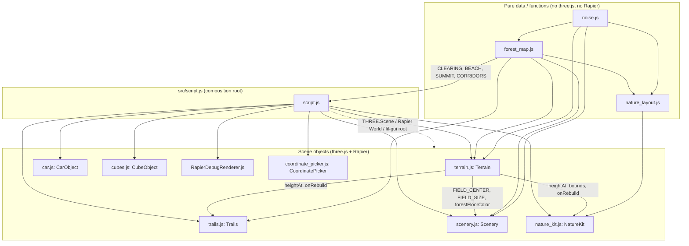
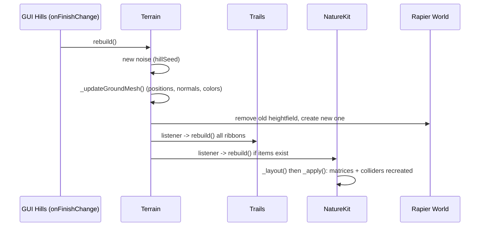
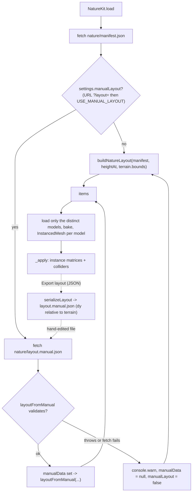
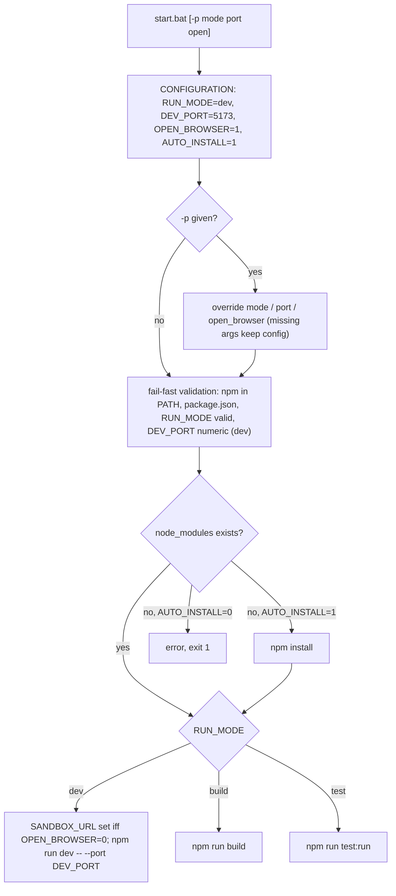

# Design Document

## Overview

This document describes the architecture of CarGoFast **as implemented today**. It is a baseline, not a proposal: every section was checked against the source (`src/script.js`, `src/objects/*.js`, `vite.config.js`, `start.bat`, `.github/workflows/deploy-pages.yml`, `package.json`). The behavior is specified by `requirements.md`; this document explains which code realizes each requirement and how the parts are wired together.

CarGoFast is a browser 3D driving sandbox: a raycast-vehicle car (Rapier) drives in a three.js scene made of a start area, a procedural terrain field with a forest map (paths, clearing, beach/sea, spiral mountain trail), a Kenney Nature Kit forest, and backdrop scenery.

How to read it: each section has a **Covers:** line listing the requirement IDs it realizes. The last section is the full requirement-to-design table.

Constraints that shape everything (from the code):

- Plain JavaScript ES modules, no framework, no TypeScript. `script.js` is the only composition root and uses top-level `await` (so `build.target = 'esnext'`).
- One shared Rapier `World` and one three.js `Scene`, passed to each object's constructor (`new X(scene, world, gui, ...)`). There is no event bus; the only observer mechanism is `Terrain.onRebuild(fn)`.
- Debug UI is a single lil-gui root; each object adds its own folder and its defaults are the code constants.
- World units are meters; y is up. The start area is around the origin, the forest world is west (x < -20).
- Objects follow one convention: tunable constants at the top of each file (`// *** ... SETTINGS ***`), then a class with a `settings` object bound to the GUI.

## Architecture

### Module map



### Construction order in `script.js`

Order matters because of `onRebuild` listener registration and because later objects read earlier ones:

1. GUI root, constants, renderer, scene, camera, `OrbitControls`, camera GUI folder, sun (`DirectionalLight`).
2. `await RAPIER.init()`, then `new RAPIER.World(gravity)`.
3. Original platforms and stairs (fixed boxes shifted by `PLATFORMS_DEPTH`).
4. `TERRAIN` -> `TRAILS` (listener 1) -> `SCENERY` -> `NATURE` (listener 2; `NATURE.load()` runs async and logs `Nature kit load error:` on failure) -> `CUBES` -> `CAR` (starts async glTF load) -> `debugRenderer`.
5. Warp table, Warp GUI, `?warp=` / `?cam=` parsing, `PICKER`, Ctrl+R handler.
6. `animate()` starts (`requestAnimationFrame` loop).

Covers: REQ-PHY-001, REQ-CAM-001, REQ-GUI-001, REQ-BLD-001.

### Physics ownership

| Collider source | Rapier body | Notes |
|---|---|---|
| Terrain heightfield | fixed body at `FIELD_CENTER` | replaced on every `rebuild()` |
| Far land (3 boxes) + seabed box | one fixed body in `Scenery` | built once |
| Nature Kit colliders | one fixed body in `NatureKit` | removed and recreated on every `_apply` |
| Platforms and stairs | one fixed body each in `script.js` | under the map |
| Car | dynamic body + chassis cuboid + vehicle controller | created when the glTF has loaded |
| Test cube | dynamic body + cuboid | exists even though hidden (see Open points) |

Covers: REQ-PHY-001, REQ-PHY-002, REQ-SCN-003, REQ-NAT-002, REQ-TER-001.

## Components and Interfaces

### script.js (composition root, loop, camera, warp)

**Responsibility.** Create everything, own the fixed-step loop, the three camera modes, the Warp feature and the global keyboard shortcut.

**Key data.**

- Constants: `GRAVITY_Y = -20.81`, `FIXED_TIMESTEP = 1/60`, `MAX_DT = 0.033`, camera (`CAM_FOV 60`, `CAM_NEAR 0.1`, `CAM_FAR 900`, `CAM_INIT_POS (0,12,-11)`), `LIGHT_*`, `PLATFORMS_DEPTH = -60`, `WARP_DROP_HEIGHT = 2.5`, `WARP_CAM_BEHIND = 11`, `WARP_CAM_HEIGHT = 12`.
- `CAMERA_MODE.mode` (`'fixed'` default | `'follow'` | `'independent'`), `camOffset` (mutable copy of `CAM_OFFSET`), `FREE_CAM {speed, sensitivity}`, `freeCam {yaw, pitch, keys}`.
- `WARPS` table: `entrance`, `clearing`, `beach`, `foot`, `summit`, each `{label, x, z, yaw}`. `foot` is the first point of the `trail` corridor, with yaw toward its fourth point.
- `pendingWarp` / `pendingCam` from `location.search`.

**Interfaces it uses.**

- `warpTo(key, camOffsetOverride?)`: `entrance` calls `CAR.reset()`, others call `CAR.teleport(x, TERRAIN.heightAt(x,z) + WARP_DROP_HEIGHT, z, yaw)`; then places `camera` and `controls.target`.
- Picker wiring: `getTargets = [TERRAIN.ground, SCENERY.farLand, SCENERY.sea, SCENERY.mountains, NATURE.group]`, `isActive = mode !== 'independent'`.

**Camera behavior per mode** (evaluated every frame after the physics steps):

| Mode | OrbitControls | Per-frame logic |
|---|---|---|
| `fixed` | enabled | `controls.target.lerp(carMesh.position, 0.1)`, `controls.update()` |
| `follow` | disabled | camera lerps (0.1) to car position + `camOffset` rotated by the car quaternion, `lookAt(car)` |
| `independent` | disabled | camera quaternion from `freeCam.yaw/pitch`; WASD/Space/ShiftLeft move at `FREE_CAM.speed`; car and cube input blocked; pointer lock on canvas click |

The wheel listener is shared: in `independent` it scales `FREE_CAM.speed` by `FREE_CAM_WHEEL_FACTOR = 1.2` within 1..200; otherwise it adjusts `camOffset.z/y` within their limits and calls `preventDefault()`. In `fixed` mode `camOffset` is not read by the per-frame logic, while OrbitControls also handles the wheel (open point).

Covers: REQ-CAM-001..005, REQ-GUI-002, REQ-PHY-001, REQ-PHY-002, REQ-SCN-001 (sun), REQ-CAR-002 (Ctrl+R reset), REQ-CAR-007.

### CarObject (`car.js`)

**Responsibility.** Load the model, build the Rapier raycast vehicle, read the keyboard, drive the physics, animate wheels and body.

**Public interface.**

| Member | Meaning |
|---|---|
| `new CarObject(scene, world, gui)` | registers key listeners on `window`, adds GUI folder `Car`, starts `loadCar` |
| `ready` | `true` only after model, rigid body and vehicle controller exist |
| `inputBlocked` | set by `script.js` in `independent` mode |
| `prePhysicsStep(dt)` | called once per fixed step, before `world.step()`: reads keys, sets engine/brake/steering, calls `vehicle.updateVehicle(dt)` |
| `update(dt)` | per frame: copy body pose to the mesh, `_animateWheels()` |
| `getMesh()` | wrapper group or `null` until `ready` |
| `teleport(x,y,z,yaw)` / `reset()` | no-op before `ready`; clears motion and animation state |
| `settings` | `engineForce`, `maxSteer`, `suspStiffness`, `frictionSlip` (GUI-bound) |

**Construction details (`loadCar`).** Wheels are found as meshes whose name contains `whell`; front wheels are those with z >= mean z. Each wheel gets a pivot `Object3D` so steering (pivot) and spin (mesh) are independent. Only body meshes are lifted (`geometry.translate`, `MODEL_BODY_LIFT = 0.50`), so physics is unaffected. The chassis cuboid is the model box scaled by `CHASSIS_W/H/L_FRAC = 0.70 / 0.25 / 0.75` and raised by `CHASSIS_OFFSET_Y = 0.45`. The vehicle uses `indexUpAxis = 1`, forward axis 2, suspension direction `(0,-1,0)`, axle `(-1,0,0)`.

**Drive model per step.**

1. Read `W/S/A/D` (all false while `inputBlocked`).
2. Throttle: `+/- settings.engineForce` on all 4 wheels.
3. No throttle: coasting. On release the horizontal velocity is stored; every step the body horizontal velocity is overwritten with `stored * (1 - t/COAST_STOP_TIME)` (vertical kept); at `t >= 1.5 s` the brake `BRAKE_FORCE = 1.5` is applied. Yaw angular velocity is damped by `exp(-18 dt)` and steering is reduced to `BRAKE_STEER_FACTOR = 0.18`.
4. Steering: target = `maxSteer * factor(speed)` with the factor going linearly from 1 to `STEER_MIN_FACTOR = 0.35` between 4 and 14 m/s; the current angle moves 0.15 toward the target each step; applied to front wheels only.

**Visual animation (`_animateWheels`).** Wheel spin from `vehicle.wheelRotation(i) * WHEEL_SPIN_DIR (-1)`; wheel travel from `wheelSuspensionLength - radius - SUSP_REST_LEN` times `WHEEL_VISUAL_TRAVEL_SCALE (1.0)`; body bob (`HOOD_SYNC_*`) and pitch (`BODY_PITCH_*`) are smoothed with lerps.

**Errors.** The glTF error callback logs `Car load error:`; `ready` stays `false`, so every other method is a no-op.

Covers: REQ-CAR-001..006.

### CubeObject (`cubes.js`)

Controllable test cube with its own `Cube` GUI folder (`speed`, `turnSpeed`) and its own `window` key listeners. `script.js` sets `inputBlocked = true`, hides the mesh and does not call `CUBES.update()`. `CUBES.reset()` is still called by Ctrl+R. Because `update()` is the only place that copies body pose to the mesh, the hidden mesh is not synchronized; the dynamic body and collider still exist in the world.

Covers: REQ-CAR-007.

### Terrain (`terrain.js`)

**Responsibility.** Own the 160 x 160 m terrain field: one height function, the visual mesh, the Rapier heightfield, and a rebuild notification.

**Public interface.**

| Member | Meaning |
|---|---|
| `ground` | `Mesh` named `Terrain` (vertex colors) |
| `bounds` | `{minX:-180, maxX:-20, minZ:-80, maxZ:80}` (derived from `FIELD_CENTER`/`FIELD_SIZE`) |
| `heightAt(x, z)` | world surface height |
| `relHeight(lx, lz)` | height relative to the field center (the single source of truth) |
| `hills(lx, lz)` | meadow hills only |
| `rebuild()` | regenerate noise, mesh, collider, then call all listeners |
| `onRebuild(fn)` | register a listener |
| `settings` | `hillAmplitude`, `hillWavelength`, `hillSeed` (GUI folder `Hills`, rebuild on `onFinishChange`) |

**Height function.**

```
relHeight = carvePaths( hills + mountainHeight + basinHeight , wx, wz )     // forest_map.js
hills     = hillAmplitude * smoothstep(0.5, 0.72, fbm(...)) * edgeRamp * basinFade * mountainFade
```

`edgeRamp` is 0 at the ground edge (x = -20) and at z = +/-80 over `HILL_FLAT_MARGIN = 20`; `basinFade` is 0 at the bottom of the sea basin; `mountainFade` is 0 on the summit. `hillAmplitude <= 0` short-circuits to 0.

**Mesh and collider.** The mesh and the collider both sample `relHeight` on the same 1 m grid (`FIELD_CELL`), so they agree at grid points. The Rapier heightfield array is column-major: `heights[row + col * (rows + 1)]`, rows along z, columns along x, scale `{x: 160, y: 1, z: 160}`, friction 0.5. `_replaceCollider()` removes the old collider before creating the new one on the same fixed body. Vertex colors come from `_paint()`: `forestFloorColor` patches, rock on steep/high ground, sand near the beach, seabed color under `WATER_Y`.

`forestFloorColor(wx, wz)` is exported and reused by `Scenery` for the far-land texture so both surfaces meet without a seam.

Covers: REQ-TER-001..003.

### Trails (`trails.js`)

One `Mesh` per entry of `CORRIDORS`, each a ribbon (`LATERAL_SEGMENTS = 4`, width `WIDTH_SCALE 1.08 x` path width) draped on `terrain.heightAt` with a lift of `0.07 + 0.012 * corridorIndex`, polygon offset -2, vertex colors center/edge dirt with up-to-12% darkening per row. It subscribes with `terrain.onRebuild(() => this.rebuild())`. Visual only, no collider.

Covers: REQ-MAP-006.

### Scenery (`scenery.js`)

**Responsibility.** Backdrop: ambient light, fog, far land (visual + colliders), sea, backdrop mountains.

| Part | Implementation | Public handle |
|---|---|---|
| Ambient | `HemisphereLight(0xffffff, 0x8a9a7a, 1.0)` | `ambientLight` |
| Fog | `scene.fog = new Fog(scene.background, 150, 520)` | - |
| Far land (visual) | `ShapeGeometry`: disc R 900 at `y = LOWLAND_Y`, minus the part west of `SEA_EDGE_X`, minus the terrain-field rectangle; planar UV from world x/z; 512 px `DataTexture` over 600 m baked from `forestFloorColor` | `farLand` |
| Far land (physics) | three cuboids (east, north, south of the field) within +/-300 m, plus a seabed cuboid at `SEABED_Y` west of `SEA_EDGE_X` | `farLandColliders` |
| Sea | `PlaneGeometry` between x = -1000 and `SEA_EAST_X = -140`, 1800 m in z, at `WATER_Y`, transparent, not animated | `sea` |
| Backdrop mountains | `InstancedMesh` of 48 six-sided cones on a 260..340 m ring around `SCENERY_CENTER (-60, 0)`, seed 5, per-instance brightness 0.7..1 | `mountains` |

GUI folder `Scenery`: ambient, fog near/far, show mountains, mountain tint.

The visual disc (R 900) is larger than the solid area (+/-300 m); outside the solid area there is no support under the car (open point). The terrain field is cut out of the far-land shape so the terrain mesh meets it edge to edge.

Covers: REQ-SCN-001..005, REQ-MAP-004 (water/seabed constants consumed here).

### NatureKit (`nature_kit.js`)

**Responsibility.** Load the Kenney models the layout needs, render them instanced, create colliders, keep everything snapped to the terrain, switch/export layouts.

**Public interface.**

| Member | Meaning |
|---|---|
| `group` | `Group` named `Nature Kit` (picker target) |
| `load()` | idempotent (`ready ??= _load()`); returns a promise |
| `rebuild()` | re-run `_layout()` and `_apply()` (called on `terrain.onRebuild` once items exist) |
| `setPalette(kind)` | `'natural'` or `'original'`; resets brightness to the palette default |
| `exportLayoutJson()` / `downloadLayout()` | current layout in the manual-file format; download as `layout.manual.json` |
| `settings` | `visible`, `palette`, `brightness`, `manualLayout` |

**Load pipeline (`_load`).**

1. `fetch('nature/manifest.json')` -> `info` map by model name.
2. If `settings.manualLayout`: `_loadManual()` (on any failure: `console.warn`, `manualData = null`, checkbox set back to false).
3. `_layout()`: `layoutFromManual(...)` when `manualData` is set, else `buildNatureLayout({manifest, heightAt, field: terrain.bounds})`.
4. For each distinct model name: `GLTFLoader.loadAsync('nature/<name>.glb')`, then `bakeModel()` merges all meshes into one geometry with `color` attribute (both palettes stored in `geometry.userData.palettes`).
5. One shared `MeshStandardMaterial` (vertex colors, roughness 0.9, metalness 0), one `InstancedMesh` per model (`castShadow = CAST_SHADOWS = false`, `frustumCulled = false`).
6. `_apply(layout)`: write instance matrices (`compose(position, rotY about up, uniform scale)`), then remove all old colliders and create new ones.

`_apply` relies on the layout order being independent of terrain height, so item *k* of a model maps to instance *k* after a rebuild.

**Colliders (`_colliderFor`).**

| `collider.kind` | Rapier shape | Placed from |
|---|---|---|
| `cylinder` | `cylinder(halfHeight, radius)` at `(x, y + centerY, z)` | tree/palm trunks |
| `box` | `cuboid` from the manifest bbox x `scale` x `shrink` (default 1; layout uses 0.8), rotated by `rotY` | cliffs, tents, log stacks |
| `hull` | `convexHull` of de-duplicated model vertices (precision 1/1000), scaled and rotated; falls back to `box` if Rapier returns `null` | large rocks, stumps |
| none (`null`) | no collider | everything else, including the pier, `platform-beach`, `platform-stone` |

**Layout source resolution.** `resolveManualLayout()`: URL `?layout=manual|generated` first, then `USE_MANUAL_LAYOUT` (default `false`). Toggling the GUI checkbox calls `_switchLayout`, which reloads the page with the parameter set, because the set of models to load differs between layouts.

**Palette.** `NATURAL_PALETTE` re-colors Kenney materials by material name; unknown names keep the original color. Defaults: palette `natural`, brightness `1.0` (`original`: `0.65`).

GUI folder `Nature Kit`: Manual layout (reloads), Export layout (JSON), Show Models, Brightness (0.1..1.5), Palette.

Covers: REQ-NAT-001, REQ-NAT-002, REQ-NAT-008, REQ-NAT-009.

### Nature layout generator (`nature_layout.js`)

**Responsibility.** Pure, deterministic placement of models. No three.js or Rapier.

**Interface.**

- `buildNatureLayout({manifest, heightAt, field}) -> {items, stats}`
- `serializeLayout(items, heightAt) -> {version, items}` and `layoutFromManual(data, {manifest, heightAt}) -> {items, stats}`
- Exports: `KIT_SCALE = 4`, `TREE_COUNT = 340`, `FAR_TREE_COUNT = 2200`, `MANUAL_LAYOUT_VERSION = 1`, spacing/clearance constants.

**How it works.**

- One seeded RNG (`LAYOUT_SEED = 17`, `seededRandom`), model groups chosen by name regex (`tree-`, `flower-`, `rock-tall`, `cliff-`, ...), `cycler` (shuffled round-robin so every model appears before repeats).
- `put(name, x, z, opts)` computes `y = baseY - bbox.min.y * scale` and returns the item. The generator-only collider kind `trunk` is converted there into a `cylinder` (`radius = 0.06 * scale`, `halfHeight = 0.3 * height / 2`).
- Spots are found with `findSpot` over a list of reserved circles (`reserve` / `isFree`). Accept rules use `landHeight` and `distToPaths` from `forest_map.js`, never the random hills, so regenerating hills only moves items vertically.
- Fixed generation order: 1 summit, 2 camp, 3 beach/pier/palms/rocks/lilies, 4 path decoration, 5 big/large rocks and cliff outcrops, 6 trees (mountain pines, broadleaf, undergrowth, moss, stumps, logs), 7 flower patches and small stones, 8 far forest. The far forest uses a spatial hash, `inFarForest()` from `forest_map.js`, and puts trees at `baseY = LOWLAND_Y` with tag `far`.
- `put` throws `unknown model <name>` if the manifest lacks a model.

Covers: REQ-NAT-003..007.

### CoordinatePicker (`coordinate_picker.js`)

Debug tool, off by default. Pointer listeners on the canvas; hover tooltip throttled to 40 ms; a click is a press and release within 5 px; pins are red cones in `pinGroup` with DOM labels projected every frame by `update()`; max 20 pins, lifetime `pinSeconds` (default 10, 0 = never) with a 1 s shrink/fade. `pick()` ray casts `getTargets()` and takes the first visible `Mesh` hit (visibility is checked up the parent chain because the raycaster ignores `visible`). Cursor is `crosshair` while enabled. `formatCoords` avoids `-0.0`.

GUI folder `Coordinates`: enable checkbox, pin lifetime, Clear pins, Last click.

Covers: REQ-GUI-003.

### RapierDebugRenderer (`RapierDebugRenderer.js`)

A `LineSegments` mesh refreshed from `world.debugRender()` each frame only while `settings.enabled` (default `false`, GUI `Debug Renderer > Show Colliders`). Off by default because the heightfield produces roughly 50k edges.

Covers: REQ-GUI-004.

### Debug GUI

A single `lil-gui` root created at the top of `script.js`. Folders and owners: `Camera` (script.js), `Car`, `Cube`, `Hills` (Terrain), `Scenery`, `Nature Kit`, `Debug Renderer`, `Warp` (script.js), `Coordinates`. Every control binds to the owner's `settings` object initialized from the file constants, so GUI defaults equal code defaults.

Covers: REQ-GUI-001, REQ-CAR-004, REQ-CAM-004.

## Data Flow

### Frame and fixed-step loop

```mermaid
sequenceDiagram
    participant RAF as requestAnimationFrame
    participant A as animate(now)
    participant C as CarObject
    participant W as Rapier World
    participant Cam as Camera logic
    participant P as PICKER
    participant R as Renderer

    RAF->>A: now
    A->>A: if pendingWarp and CAR.ready: warpTo(), clear pendingWarp
    A->>A: dt = min(0.033, (now-last)/1000); accumulator += dt
    loop while accumulator >= 1/60
        A->>C: prePhysicsStep(1/60)
        A->>W: step()
    end
    A->>C: update(dt)
    A->>A: debugRenderer.update()
    A->>Cam: apply fixed / follow / independent
    A->>P: update()
    A->>R: render(scene, camera)
```

`CUBES.update()` is intentionally absent (commented out). Rapier uses its default integration step; the accumulator guarantees `world.step()` is called at 60 Hz of simulated time.

Covers: REQ-PHY-001, REQ-CAR-002, REQ-CAR-003, REQ-CAM-001..004.

### Terrain rebuild -> listeners



The constructor of `Terrain` calls `rebuild()` once before any listener exists, so initial placement does not go through this path. `Scenery` does not subscribe: its far land does not depend on the hills.

Covers: REQ-TER-001, REQ-TER-002, REQ-MAP-006, REQ-NAT-001.

### Layout: generated vs manual



Covers: REQ-NAT-001, REQ-NAT-003, REQ-NAT-008, REQ-NAT-009.

### Warp

`GUI Warp button` or `?warp=<key>[&cam=dx,dy,dz]` -> `warpTo(key, cam)` -> car teleport at terrain height + 2.5 m -> camera placed 11 m behind and 12 m above (or the `cam` offset in world axes) and `controls.target` set. The URL form is deferred in `animate()` until `CAR.ready`, then executed once.

Covers: REQ-GUI-002, REQ-CAR-006.

## Data Models

### Forest map (`forest_map.js`)

Pure module: constants, geometry builders executed at import time, and query functions. No dependency except `noise.smoothstep`.

**Constants (exported).**

| Group | Names |
|---|---|
| Widths | `PATH_WIDTH 8`, `TRAIL_WIDTH 8`, `PATH_SHOULDER 7`, `TRAIL_SHOULDER 8` |
| Points | `ENTRANCE (-20,0)`, `BEACH (-160,9)`, `CLEARING {x:-62, z:50, radius:15, feather:10}` |
| Sea | `WATER_Y -1.2`, `SEABED_Y -4`, `SEA_EDGE_X -176`, `BASIN {startX:-148, length:32, depth:3.6}` |
| Mountain | `MOUNTAIN {x:-110, z:-40, radius:34, height:26}`, `SUMMIT {x,z,y}`, `TRAIL_LENGTH` |
| Levels | `LOWLAND_Y 0` |
| Far forest | `FAR_FOREST {center:(-60,0), radius:240, fieldMargin:4, meadow, seaMargin:6}` |

**Corridor** (element of `CORRIDORS`, order `main`, `clearing`, `access`, `trail`; the order is also the Trails lift index):

```
{ name, kind: 'path' | 'trail', halfWidth, shoulder,
  pts: [{ x, z, y }],          // centerline; y = height the terrain is carved to
  bbox: { minX, maxX, minZ, maxZ } }   // includes halfWidth + shoulder, for quick rejection
```

**Construction.**

- `main`, `clearing`, `access`: hand-placed waypoints -> `smoothPolyline` (Catmull-Rom, 24 sub-samples per segment, resampled every `SAMPLE_STEP = 2` m). Center height: `basinHeight(x)` for `main`, 0 for the others. `access` goes from `ACCESS_JUNCTION (-98,-2)` to `startOfTrail()`, the point of the mountain circle in the junction's direction.
- `trail`: `buildTrail()` integrates a counter-clockwise spiral from the mountain radius inward in 1 m points (8 substeps each). At every substep the inward share is `min(TRAIL_INWARD_MAX 0.6, TRAIL_MAX_SLOPE 0.12 / slope(r))`, which is what bounds the gradient; it stops at `TRAIL_TOP_RADIUS = 1.5` and appends the summit center.

**Queries.**

| Function | Use |
|---|---|
| `mountainHeight(x,z)`, `basinHeight(x)` | terrain components (flat top plateau 15% of radius; smoothstep basin) |
| `nearestOnCorridor(c,x,z) -> {dist, y}` | nearest centerline point and its height |
| `distToPaths(x,z)` | min distance to any corridor (layout clearances) |
| `carvePaths(natural,x,z)` | blend toward corridor height over `halfWidth..halfWidth+shoulder` (smoothstep), then blend to 0 inside the clearing disc + feather |
| `landHeight(x,z)` | `carvePaths(mountainHeight + basinHeight)`; no hills; used for layout decisions |
| `inFarForest(x,z,field)` | far-forest region test |

Covers: REQ-MAP-001..005, REQ-NAT-007 (region), REQ-TER-001.

### Layout item and collider

```
Item     = { name, x, y, z, rotY, scale, collider: Collider | null, tag, top }
Collider = { kind: 'cylinder', radius, halfHeight, centerY }
         | { kind: 'box', shrink }
         | { kind: 'hull' }
           // generator-internal: { kind: 'trunk' } is resolved to 'cylinder' inside put()
Manifest = [{ name, size: [x,y,z], min: [x,y,z], max: [x,y,z] }]       // nature/manifest.json (kit units)
```

Placement rule: `y = baseY - min.y * scale` (the lowest point of the model rests on `baseY`; default terrain height at (x, z)). `top = y + max.y * scale`. Tags in use: `summit`, `camp`, `pier`, `beach`, `palm`, `decor`, `bigrock`, `rock`, `cliff`, `pine`, `tree`, `undergrowth`, `moss`, `stump`, `log`, `patch`, `clearing`, `smallrock`, `far`.

### Manual layout file (`src/static/nature/layout.manual.json`)

```
{ "version": 1,
  "items": [ { "name", "x", "z", "dy", "rotY", "scale", "tag", "collider" }, ... ] }
```

| Field | Required | Default | Notes |
|---|---|---|---|
| `name` | yes | - | must exist in `manifest.json` |
| `x`, `z` | yes | - | finite numbers |
| `dy` | no | 0 | offset from the terrain at (x, z); the item still follows the hills |
| `rotY` | no | 0 | radians |
| `scale` | no | `KIT_SCALE` (4) | uniform |
| `tag` | no | `'prop'` | |
| `collider` | no | `null` | one of the three kinds above |

Export writes `x`,`z` with 2 decimals, `rotY` 3, `scale` 3, `dy` 3, collider numbers 3; the file has one item per line (`exportLayoutJson`). `version` may be omitted when reading; any value other than 1 is rejected.

Validation (`layoutFromManual`) throws on: missing `items` array, unsupported version, unknown model, non-finite `x/z/dy/rotY/scale`. It does not validate `tag` or the collider object.

Covers: REQ-NAT-008, REQ-NAT-009.

### Warp table

`WARPS = { entrance, clearing, beach, foot, summit }`, each `{label, x, z, yaw}` (yaw 0 = facing +z). Values come from `CLEARING`, `BEACH`, `SUMMIT` and the `trail` corridor. `entrance` is not the map entrance (-20, 0): it is `(0, 0)` and in practice `CAR.reset()` (spawn (0, 3, 0)).

Covers: REQ-GUI-002.

## Error Handling

| Situation | Where | Behavior |
|---|---|---|
| Car glTF fails to load | `car.js` error callback | `console.error('Car load error:', err)`; `ready` stays false; input, physics step, `update`, `teleport`, camera-follow all skip; the rest of the game keeps running |
| Warp/teleport before the car is ready | `CarObject.teleport`, `animate()` | `teleport` ignored; URL warp is kept in `pendingWarp` until `CAR.ready` |
| Nature Kit load fails (manifest fetch, a `.glb`) | `script.js` `.catch` | `console.error('Nature kit load error:', err)`; the game runs without kit models (no kit colliders; `NATURE.group` is empty) |
| Manual layout missing/invalid | `NatureKit._loadManual` | `console.warn('Manual layout unavailable (<reason>); using the generated layout.')`; falls back to generated and unchecks the GUI box |
| Convex hull cannot be built | `NatureKit._colliderFor` | uses the `box` collider |
| Layout references a model missing from the manifest | `put()` / `layoutFromManual` | throws; for the generated layout this rejects `load()` (logged as above); for the manual layout it triggers the fallback |
| `?warp=` with unknown key | `script.js` | ignored (`pendingWarp = null`) |
| `?cam=` malformed | `script.js` | not validated: values are parsed with `Number`, so missing or non-numeric parts become `NaN` or `undefined` and reach the camera |
| Terrain `hillAmplitude <= 0` | `Terrain.hills` | returns 0 (flat meadow) |
| Car falls outside solid areas | Physics | no handler; there is no kill plane or automatic reset (open point) |
| `start.bat` validation | `start.bat` | `npm` missing, no `package.json`, invalid `RUN_MODE`, non-numeric `DEV_PORT` (dev), missing `node_modules` with `AUTO_INSTALL=0`, or failed `npm install` -> message on stderr, exit code 1 |

Covers: REQ-CAR-001, REQ-CAR-006, REQ-NAT-001, REQ-NAT-008, REQ-GUI-002, REQ-BLD-002.

## Build, Run and Deploy

### Vite (`vite.config.js`)

| Setting | Value | Why |
|---|---|---|
| `root` | `src/` | `index.html` lives in `src/` |
| `publicDir` | `static` (relative to root) | `src/static/*` is served at `/` (`LowPolyCars.gltf`, `nature/...`) |
| `base` | `./` | relative asset URLs so GitHub Pages sub-path works |
| `build.outDir` / `emptyOutDir` / `sourcemap` / `target` | `../dist` / `true` / `true` / `esnext` | `esnext` is required by the top-level `await` in `script.js` |
| `server.host` | `true` | reachable on the local network |
| `server.open` | `!('SANDBOX_URL' in env \|\| 'CODESANDBOX_HOST' in env)` | `start.bat` uses `SANDBOX_URL` to suppress the browser |
| plugin | `vite-plugin-restart` with `'../static/**'` | resolved against `root`, so it points at `<project>/static/**` (open point) |

Runtime asset URLs (`LowPolyCars.gltf`, `nature/manifest.json`, `nature/<model>.glb`, `nature/layout.manual.json`) are relative with no leading `/`; this is what keeps `base: './'` working.

`package.json` scripts: `dev` = `vite`, `build` = `vite build`, `test` = `vitest`, `test:run` = `vitest --run`. Runtime dependencies: `three ^0.174`, `@dimforge/rapier3d-compat ^0.18`, `lil-gui ^0.20`. `@dimforge/rapier3d` and `jest` are installed but unused by the code.

### `start.bat`



The script changes to its own directory first (`cd /d "%~dp0"`) and returns the exit code of the npm command. Its comments and messages are in Romanian; the port comment says 1024-65535 but only "numeric" is checked.

### GitHub Pages (`.github/workflows/deploy-pages.yml`)

Trigger: push to `main` or `workflow_dispatch`. Permissions: `contents: read`, `pages: write`, `id-token: write`. Concurrency group `pages`, `cancel-in-progress: true`.

- Job `build` (`ubuntu-latest`, Node 20, npm cache): checkout -> `npm ci` -> `npm run test:run` -> `npm run build` -> `configure-pages@v5` -> `upload-pages-artifact@v3` with `path: dist`.
- Job `deploy` (needs `build`, environment `github-pages`): `actions/deploy-pages@v4`.

Published at `https://matei-rares-a.github.io/cargofast/`; requires repository Settings > Pages > Source = "GitHub Actions". The pipeline includes a test step that the baseline requirements do not cover (open point).

Covers: REQ-BLD-001, REQ-BLD-002, REQ-BLD-003.

## Open Points That Affect the Design

Listed as found; none is resolved here. Numbers refer to "Open Questions" in `requirements.md`.

| # | Design impact |
|---|---|
| 1 | Wheel handler edits `camOffset` in `fixed` mode, but only `follow` reads it; OrbitControls zoom runs on the same wheel event. |
| 2 | Shadow map is enabled and the sun has `castShadow = true`, but only the hidden cube sets `castShadow`; `NatureKit` uses `CAST_SHADOWS = false`. |
| 3 | Resize handler is commented out in `script.js`; renderer and camera aspect keep their initial values. |
| 4 | `car.js` and `cubes.js` call `preventDefault()` on every `keydown`/`keyup` on `window`. |
| 5 | Solid ground is +/-300 m (plus the field heightfield and the seabed); no kill plane. |
| 6 | Coasting overwrites horizontal velocity every step while neither W nor S is pressed, including at start. |
| 8 | Pier and platforms have no collider in `nature_layout.js` (`put` without `collider`). |
| 9 | The hidden cube keeps a dynamic body and collider in the world; only the mesh sync is skipped. |
| 10 | `vite-plugin-restart` glob is resolved against `root: 'src/'`. |
| 12 | The deploy workflow runs `npm run test:run` before the build. |
| 16 | Warp `entrance` is `(0, 0)` / `CAR.reset()`, not the forest entrance `(-20, 0)`. |

Open questions 7, 11, 13, 14, 15 do not change the structure described here (trail width in code is 8 m; `start.bat` port check; unused assets and dependencies; manual file sync; performance).

## Requirement-to-Design Traceability

| Requirement | Design section |
|---|---|
| REQ-CAR-001 | CarObject (construction, errors); Error Handling |
| REQ-CAR-002 | CarObject (drive model); script.js (Ctrl+R); Frame and fixed-step loop |
| REQ-CAR-003 | CarObject (drive model, coasting) |
| REQ-CAR-004 | CarObject (`settings`, GUI); Debug GUI |
| REQ-CAR-005 | CarObject (visual animation) |
| REQ-CAR-006 | CarObject (`teleport`, `reset`); Warp; Error Handling |
| REQ-CAR-007 | CubeObject; script.js; Open Points 9 |
| REQ-PHY-001 | script.js (constants, order); Frame and fixed-step loop; Physics ownership |
| REQ-PHY-002 | Physics ownership; script.js (platforms and stairs) |
| REQ-CAM-001 | script.js (renderer, camera); Construction order |
| REQ-CAM-002 | script.js (camera per mode, `fixed`) |
| REQ-CAM-003 | script.js (camera per mode, `follow`) |
| REQ-CAM-004 | script.js (camera per mode, `independent`); Debug GUI |
| REQ-CAM-005 | script.js (shared wheel listener); Open Points 1 |
| REQ-TER-001 | Terrain (bounds, height function, mesh/collider, rebuild); Terrain rebuild flow; Forest map |
| REQ-TER-002 | Terrain (hills, GUI); Terrain rebuild flow |
| REQ-TER-003 | Terrain (`_paint`, `forestFloorColor`) |
| REQ-MAP-001 | Forest map (constants, construction of `main`) |
| REQ-MAP-002 | Forest map (`clearing`, `CLEARING`) |
| REQ-MAP-003 | Forest map (`access`, `trail`, `buildTrail`, `MOUNTAIN`, `SUMMIT`, `CORRIDORS`) |
| REQ-MAP-004 | Forest map (sea constants); Scenery (sea, seabed) |
| REQ-MAP-005 | Forest map (`carvePaths`, `landHeight`) |
| REQ-MAP-006 | Trails; Terrain rebuild flow |
| REQ-NAT-001 | NatureKit (load pipeline, palette, GUI); Layout generated vs manual; Error Handling |
| REQ-NAT-002 | NatureKit (colliders); Physics ownership |
| REQ-NAT-003 | Nature layout generator (determinism, order, tags); Layout item |
| REQ-NAT-004 | Nature layout generator (steps 1-3) |
| REQ-NAT-005 | Nature layout generator (steps 4, 6) |
| REQ-NAT-006 | Nature layout generator (steps 5, 7) |
| REQ-NAT-007 | Nature layout generator (step 8); Forest map (`FAR_FOREST`, `inFarForest`) |
| REQ-NAT-008 | NatureKit (layout source resolution); Manual layout file; Layout generated vs manual |
| REQ-NAT-009 | NatureKit (`exportLayoutJson`, `downloadLayout`); Manual layout file |
| REQ-SCN-001 | script.js (sun); Scenery (ambient, fog, GUI) |
| REQ-SCN-002 | Scenery (far land visual and texture) |
| REQ-SCN-003 | Scenery (far land and seabed colliders); Physics ownership; Open Points 5 |
| REQ-SCN-004 | Scenery (sea) |
| REQ-SCN-005 | Scenery (backdrop mountains) |
| REQ-GUI-001 | Debug GUI; Construction order |
| REQ-GUI-002 | script.js (`WARPS`, `warpTo`, URL); Warp; Warp table |
| REQ-GUI-003 | CoordinatePicker; script.js (picker wiring) |
| REQ-GUI-004 | RapierDebugRenderer |
| REQ-BLD-001 | Vite; Build, Run and Deploy |
| REQ-BLD-002 | start.bat; Error Handling |
| REQ-BLD-003 | GitHub Pages |
